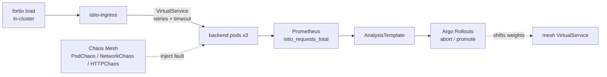

# 💥 Chaos Engineering with Chaos Mesh

> 📘 See [concepts/ChaosEngineering.md](./concepts/ChaosEngineering.md) for what chaos engineering proves that reading config can't, and why Chaos Mesh.

This guide installs [Chaos Mesh](https://chaos-mesh.org/) and runs six experiments against the `mern-devops` namespace to check that the resilience features this repo configures actually work: Istio retries/timeouts, Istio outlier detection (circuit breaking), the HPA, MongoDB loss, and Argo Rollouts' automatic abort on a failing canary.

**Requires** Istio ([Istio.md](./Istio.md)) installed, with the app deployed and the Istio manifests applied. No application code changes are involved. Manifests live in [`chaos-engineering/`](../chaos-engineering/).

> ⚠️ Run this on a throwaway cluster (all results below are from a local `kind` cluster). Check `kubectl config current-context` first.



## 1. Install

### Step 1: Chaos Mesh
The chart needs the node's container runtime (`kind` and most modern clusters use containerd):

```bash
helm repo add chaos-mesh https://charts.chaos-mesh.org
helm repo update

helm install chaos-mesh chaos-mesh/chaos-mesh -n chaos-mesh --create-namespace \
  --version 2.8.7 \
  --set chaosDaemon.runtime=containerd \
  --set chaosDaemon.socketPath=/run/containerd/containerd.sock \
  --set dashboard.create=true \
  --wait
```

Dashboard login (`securityMode`) stays at the chart default of enabled.

### Step 2: Prometheus
Needed by the canary analysis, which expects it at `prometheus.istio-system:9090`. Skip if you already have the Istio add-ons from [Istio.md](./Istio.md).

```bash
kubectl apply -f https://raw.githubusercontent.com/istio/istio/release-1.25/samples/addons/prometheus.yaml
```

### Step 3: Argo Rollouts
Server-side apply is required, because a plain `kubectl apply` fails on the CRDs with `metadata.annotations: Too long`:

```bash
kubectl create namespace argo-rollouts
kubectl apply --server-side --force-conflicts -n argo-rollouts \
  -f https://github.com/argoproj/argo-rollouts/releases/latest/download/install.yaml
```

### Step 4: Load generators
One fortio pod outside the mesh that hits the ingress gateway (experiments 1–3, 5, 6) and one inside the mesh that calls the backend Service directly (experiment 4). Scale the backend to 3 replicas so there is something to fail over to:

```bash
kubectl create namespace chaos-load
kubectl -n chaos-load run fortio --image=fortio/fortio --restart=Never -- server
kubectl -n mern-devops run loadgen --image=fortio/fortio --restart=Never -- server
kubectl -n mern-devops scale deploy/backend-deployment --replicas=3
```

### Step 5: Baseline
```bash
kubectl -n chaos-load exec fortio -- fortio load -qps 50 -t 10s -c 8 http://istio-ingress.istio-system/books
```
Expected: `Code 200 : 496 (100.0 %)`, ~6 ms average. Every experiment is compared against this.

## 2. Dashboard

The dashboard creates, watches and stops experiments from a browser; they are the same CRDs you can see with `kubectl get podchaos,networkchaos,...`. Login is a ServiceAccount token. [`rbac.yml`](../chaos-engineering/dashboard/rbac.yml) creates a Manager account scoped to `mern-devops` plus a token Secret (Kubernetes 1.24+ does not create one automatically):

```bash
kubectl apply -f chaos-engineering/dashboard/rbac.yml
kubectl -n mern-devops get secret chaos-dashboard-manager-token -o jsonpath='{.data.token}' | base64 -d
kubectl -n chaos-mesh port-forward svc/chaos-dashboard 2333:2333
```

Open `http://localhost:2333`, enter any name and paste the token.

> ⚠️ Don't expose this service outside the cluster: anyone with a Manager token can break your workloads.

## 3. Experiments 1–3: Istio on the request path

| # | Manifest | Fault | Hypothesis |
|---|---|---|---|
| 1 | [`pod-kill.yml`](../chaos-engineering/experiments/pod-kill.yml) | Kill one backend pod | Clients see no errors; the Deployment replaces the pod |
| 2 | [`network-delay.yml`](../chaos-engineering/experiments/network-delay.yml) | 4s latency on one backend pod (longer than the 3s `perTryTimeout`) | Retries absorb it |
| 3 | [`http-fault.yml`](../chaos-engineering/experiments/http-fault.yml) | HTTPChaos breaks one pod's responses | Envoy ejects the pod after 5 consecutive errors |

Run each one the same way (shown for experiment 1). Always delete the experiment afterwards so the fault ends:

```bash
kubectl -n chaos-load exec fortio -- fortio load -qps 50 -t 40s -c 8 -timeout 15s http://istio-ingress.istio-system/books &
LOAD=$!
kubectl apply -f chaos-engineering/experiments/pod-kill.yml
wait $LOAD
kubectl delete -f chaos-engineering/experiments/pod-kill.yml
```

To see whether the gateway ejected a pod, read its per-endpoint health:

```bash
GW=$(kubectl -n istio-system get pod -l app=istio-ingress -o name | head -1)
kubectl -n istio-system exec $GW -- pilot-agent request GET clusters \
  | grep -E "backend-service.mern-devops.*:8000::(health_flags|rq_error)"
```
`health_flags::/failed_outlier_check` marks an ejected endpoint; `healthy` is normal.

### Results

| # | Client-visible result | What happened |
|---|---|---|
| 1 | 2000/2000 `200` (2 runs) | A replacement pod was Ready ~30s later |
| 2 | Run 1: 2248/2248 `200`, p99.9 = 3.0s. Run 2: 2245 `200` + 3 `504`, p99.9 = 10.0s | The 3.0s is exactly `perTryTimeout`: requests that hit the slow pod timed out and were retried elsewhere. In run 2 three requests exhausted the route's total 10s `timeout`. Retries absorb the delay almost always, not always |
| 3 | 99.9–100% `200` (at most 2 `504` per ~1500 requests) | A pod was ejected (`/failed_outlier_check`) in 3 of 3 repeats of the committed manifest, and was `healthy` again ~50s after the experiment was deleted. A separate set of 3 trials aimed at a named pod ejected it in 2 of 3 |

### Takeaways

- **Retries hide most faults from clients.** `retryOn` covers `gateway-error,connect-failure,retriable-4xx`, so failed attempts are retried on another pod. Good for users, but anything that needs to *see* errors (experiment 4) must not sit behind retries.
- **HTTPChaos under Istio does not return a clean HTTP 500.** The mesh recorded dropped connections (`response_code 0`, flag `DC`). Envoy still ejected the pod.
- **`mode: one` picks a random pod**, which may get little traffic in a short run. Select a specific pod (`selector.pods`) for repeatable results.
- **Use `-timeout 15s` with fortio.** Its default 3s client timeout aborts the run on the first stalled request.

## 4. Experiment 4: Argo Rollouts auto-abort

The repo's existing canary manifests use NGINX traffic routing and had **no `AnalysisTemplate`**, so automatic rollback existed only in prose. This experiment adds one and checks it fires. Files in [`chaos-engineering/rollouts/`](../chaos-engineering/rollouts/):

| File | Purpose |
|---|---|
| [`services.yml`](../chaos-engineering/rollouts/services.yml) | Stable and canary Services |
| [`virtualservice.yml`](../chaos-engineering/rollouts/virtualservice.yml) | In-mesh route `primary` whose weights Argo Rollouts rewrites; 2s timeout, **no retries** |
| [`analysis-template.yml`](../chaos-engineering/rollouts/analysis-template.yml) | Prometheus gate: ≥ 95% `2xx` to the canary Service, checked every 15s, abort on the 2nd failure |
| [`backend-rollout.yml`](../chaos-engineering/rollouts/backend-rollout.yml) | 3-replica Rollout, steps 30% → 60%, background analysis, canary pods labelled `role=canary` |

Retries are left off on purpose: a failing canary request would otherwise be retried onto a stable pod, the success rate would stay high, and the analysis would never see the failure.

### Step 1: Switch the backend to the Rollout
```bash
kubectl -n mern-devops scale deploy/backend-deployment --replicas=0
kubectl apply -f chaos-engineering/rollouts/
kubectl -n mern-devops wait --for=jsonpath='{.status.phase}'=Healthy rollout/backend-rollout --timeout=150s
```

### Step 2: Control run (no chaos, must promote)
A gate that always aborts proves nothing, so first show a healthy canary is promoted. Start load, then trigger a new revision by bumping the `RELEASE` env var:

```bash
kubectl -n mern-devops exec loadgen -c loadgen -- \
  fortio load -qps 30 -t 330s -c 4 -timeout 10s http://backend-service-stable:8000/books &

kubectl -n mern-devops patch rollout backend-rollout --type=json \
  -p='[{"op":"replace","path":"/spec/template/spec/containers/0/env/2/value","value":"r2"}]'

kubectl -n mern-devops get rollout backend-rollout -w
```

### Step 3: Chaos run (must abort)
Start from a `Healthy` rollout (the control run must have finished). Trigger another revision, wait until it is `Paused` at step 1 with exactly one canary pod `2/2`, and only then inject latency into the canary pods:

```bash
kubectl -n mern-devops patch rollout backend-rollout --type=json \
  -p='[{"op":"replace","path":"/spec/template/spec/containers/0/env/2/value","value":"r3"}]'

kubectl -n mern-devops get rollout backend-rollout -w     # wait for: Paused, step=1
kubectl -n mern-devops get pods -l role=canary            # exactly one pod, 2/2
kubectl apply -f chaos-engineering/experiments/canary-latency.yml
```

> ⚠️ Chaos Mesh picks target pods **when you apply** the experiment; pods created later are unaffected. Old `role=canary` pods left by an unfinished rollout would take the fault instead, and the gate would see nothing.

Inspect and clean up:
```bash
kubectl -n mern-devops get rollout backend-rollout -o jsonpath='{.status.phase}{"\n"}{.status.message}{"\n"}'
kubectl -n mern-devops get analysisrun -o jsonpath='{range .items[*]}{range .status.metricResults[*].measurements[*]}{.phase} {.value}{"\n"}{end}{end}'
kubectl delete -f chaos-engineering/experiments/canary-latency.yml
```

### Results

| Run | Outcome |
|---|---|
| Control | Weights 30% → 60% → 100%; AnalysisRun `Successful`; rollout `Healthy` after ~220s (completed in 2 runs; stalled in a third, see Gotchas) |
| Chaos | Measurements `1, 1, 0.986, 0.570, 0.040` (and in an earlier run `1, 1, 0.861, 0.215`). On the 2nd failed check the rollout went `Degraded`: `Rollout aborted update ... Metric "canary-success-rate" assessed Failed due to failed (2) > failureLimit (1)`. Weights returned to `100 0` and the canary pods were removed. Abort came ~40–50s after the fault |

Notes:
- The first readings are `1` because the 1-minute window still holds healthy traffic; the gate reacts as the window fills with failures.
- A missing reading (`NaN`, no canary samples yet) counts as a failed check, which is safe (no data, no promotion) but can abort a release that never received traffic.
- An aborted Rollout stays `Degraded` until you ship a new revision or run `kubectl argo rollouts retry`.

## 5. Experiments 5–6: HPA and MongoDB

### Experiment 5: CPU stress and the HPA
The HPA needs metrics-server (on kind it must run with `--kubelet-insecure-tls`):

```bash
kubectl apply -f https://github.com/kubernetes-sigs/metrics-server/releases/latest/download/components.yaml
kubectl -n kube-system patch deploy metrics-server --type=json \
  -p='[{"op":"add","path":"/spec/template/spec/containers/0/args/-","value":"--kubelet-insecure-tls"}]'
kubectl apply -f kubernetes/hpa.yml
```

Run load (`-t 150s`) and apply [`cpu-stress.yml`](../chaos-engineering/experiments/cpu-stress.yml).

| Variant | Result |
|---|---|
| Stress **all** pods (`mode: all`, as committed) | HPA scaled the backend 3 → 5 (`cpu resource utilization (percentage of request) above target`); 7496/7496 `200` (2 runs) |
| Stress **one** pod of three (`mode: one`) | That pod hit its 500m limit but the average was ~52% vs the 50% target, inside the HPA's 10% tolerance, so it did **not** scale; 8496/8496 `200` |

The HPA scales on the average, so one hot pod among several does not trigger it.

### Experiment 6: MongoDB loss
[`mongodb-kill.yml`](../chaos-engineering/experiments/mongodb-kill.yml) kills the single MongoDB pod while load runs at 20 req/s.

| Measure | Result (2 runs) |
|---|---|
| Client requests | 99.4–99.5% `200`, 12 `504` |
| MongoDB | Back to `2/2` ~30s after the kill |
| Backend | One backend pod restarted once after the DB returned |
| Data | A book created before the kill was still returned (`count: 1`) |

Retries and outlier detection cannot hide a dependency that is down for everyone, so there is a short, real error window. Running MongoDB as a replica set would be the fix.

## 6. Gotchas

- **A canary pod often crash-loops on a small local cluster** with `MongooseServerSelectionError: connection <monitor> ... closed`, usually the second canary pod at the 60% step. The cause is unknown. Deleting the pod lets the Rollout recreate it, and it normally comes up. When it happens during the control run, promotion stalls until the pod recovers.
- **Always delete experiments after running them** (`kubectl delete -f ...`); a leftover experiment keeps the fault alive.

## 7. Cleanup
```bash
kubectl delete -f chaos-engineering/experiments/ --ignore-not-found
kubectl delete -f chaos-engineering/rollouts/
kubectl delete -f chaos-engineering/dashboard/rbac.yml
kubectl delete -f kubernetes/hpa.yml --ignore-not-found
kubectl -n mern-devops scale deploy/backend-deployment --replicas=1
kubectl delete namespace chaos-load
kubectl -n mern-devops delete pod loadgen
helm uninstall chaos-mesh -n chaos-mesh
```

## Key Benefits

- **Evidence over assumption**: retries, outlier ejection, the HPA and the canary gate were each seen working under real failure
- **Found a real gap**: the repo had no `AnalysisTemplate`; now it has a tested one
- **Showed the limits**: a down database and a single hot pod are not rescued by the mesh or the HPA
