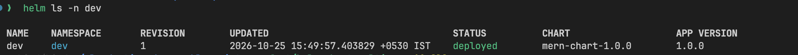
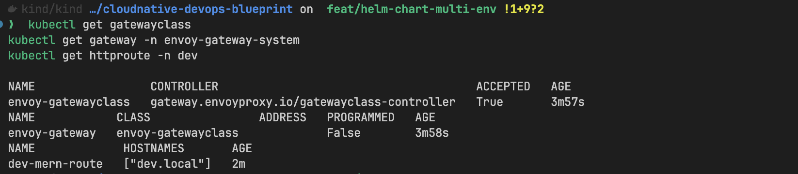
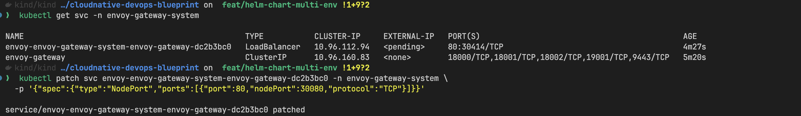

#  📦 Packaging & Deploying Applications with Helm Charts

> 📘 See [concepts/HelmVsKustomize.md](./concepts/HelmVsKustomize.md) for how Helm compares to Kustomize and when to reach for each.

## Step 1: Cluster Setup

Cluster Configuration: `kind-config.yaml`
```yaml
kind: Cluster
apiVersion: kind.x-k8s.io/v1alpha4
nodes:
  - role: control-plane
    extraPortMappings:
      - containerPort: 80   # for nginx ingress
        hostPort: 80
        protocol: TCP
      - containerPort: 30080 # for gateway api
        hostPort: 30080
        protocol: TCP
```

- Run the following command to create a Kubernetes cluster using the provided `kind-config.yaml`:

  ```bash
  kind create cluster --config kind-config.yaml
  ```

Namespace creation is handled by `--create-namespace` in Step 4 - no manual step needed.

## Step 2: Install Envoy Gateway Controller with Gateway API CRDs

```bash
helm install eg oci://docker.io/envoyproxy/gateway-helm --version v0.0.0-latest -n envoy-gateway-system --create-namespace
```

Wait for Envoy Gateway to become available:

```bash
kubectl wait --timeout=5m -n envoy-gateway-system deployment/envoy-gateway --for=condition=Available
```


## Step 3: Create the Shared Gateway

The chart's `HTTPRoute` attaches to one shared `Gateway` rather than creating
its own per release - apply this once, before installing the chart for any
environment:

```yaml
apiVersion: gateway.networking.k8s.io/v1
kind: GatewayClass
metadata:
  name: envoy-gatewayclass
spec:
  controllerName: gateway.envoyproxy.io/gatewayclass-controller

---
apiVersion: gateway.networking.k8s.io/v1
kind: Gateway
metadata:
  name: envoy-gateway
  namespace: envoy-gateway-system
spec:
  gatewayClassName: envoy-gatewayclass
  listeners:
    - name: http
      protocol: HTTP
      port: 80
      allowedRoutes:
        namespaces:
          from: All
```

Save as `gateway.yml` and apply:

```bash
kubectl apply -f gateway.yml
```

`allowedRoutes.namespaces.from: All` is what lets each environment's
`HTTPRoute` (living in `dev`/`staging`/`prod`, not `envoy-gateway-system`)
attach to this one Gateway.

## Step 4: Install the Helm Chart

One release per environment, each with its own namespace and value files.
Starting with `dev` - `staging`/`prod` follow in Step 6, once this one works:

```bash
helm install dev ./helm-chart -n dev --create-namespace \
  -f ./helm-chart/values/values-base.yaml -f ./helm-chart/values/values-dev.yaml
```

## Step 5: Verify

### List Helm releases:

```bash
helm ls -n dev
```


Check the status of all resources:

```bash
kubectl get all -n dev
```

### Verify Gateway API Resources

```bash
kubectl get gatewayclass
kubectl get gateway -n envoy-gateway-system
kubectl get httproute -n dev
```


> **⚠️ Important:** If running locally, the gateway status will show `Programmed: False` since kind has no LoadBalancer support. The NodePort patch in the next step resolves this for local access.

#### Verify Envoy Gateway Resources

```bash
kubectl get pods -n envoy-gateway-system
kubectl get svc -n envoy-gateway-system
```

### Access the Application

> **🔧 Local Testing Only:** Patch the envoy gateway service to NodePort for local access. Not needed in production (use LoadBalancer or proper DNS).

Find the envoy data-plane service (named after the `envoy-gateway` Gateway from Step 3, in `envoy-gateway-system`):

```bash
kubectl get svc -n envoy-gateway-system
```

Patch it to NodePort:

```bash
kubectl patch svc <service-name> -n envoy-gateway-system \
  -p '{"spec":{"type":"NodePort","ports":[{"port":80,"nodePort":30080,"protocol":"TCP"}]}}'
```


The `Host` header is what routes you to the right environment - point `dev.local` at localhost:

```bash
echo "127.0.0.1 dev.local" | sudo tee -a /etc/hosts
```

```bash
curl http://dev.local:30080/books
```

Or open `http://dev.local:30080` directly in a browser.

## Step 6: Other Environments

Once `dev` works, `staging`/`prod` are the same chart, same shared Gateway and
NodePort - just a different release, namespace, and values file:

```bash
helm install staging ./helm-chart -n staging --create-namespace \
  -f ./helm-chart/values/values-base.yaml -f ./helm-chart/values/values-staging.yaml

helm install prod ./helm-chart -n prod --create-namespace \
  -f ./helm-chart/values/values-base.yaml -f ./helm-chart/values/values-prod.yaml
```

Add their hostnames too, then access the same way as dev:

```bash
echo "127.0.0.1 staging.local prod.local" | sudo tee -a /etc/hosts

curl http://staging.local:30080/books
curl http://prod.local:30080/books
```

Or open `http://staging.local:30080` / `http://prod.local:30080` in a browser.

## Step 7: Cleanup

```bash
helm uninstall dev -n dev
helm uninstall staging -n staging
helm uninstall prod -n prod
```

This doesn't remove the namespaces or the shared Gateway from Step 3. Full teardown:

```bash
kubectl delete namespace dev staging prod
kubectl delete -f gateway.yml
```

---

## (Optional) Publish Helm Chart to GHCR (OCI)

This project supports publishing and consuming the Helm chart using **GitHub Container Registry (GHCR)** as an **OCI registry**.

---

### 1) Login to GHCR

```bash
export GHCR_USERNAME="atkaridarshan04"
export GHCR_TOKEN="<your_github_token>"

echo $GHCR_TOKEN | helm registry login ghcr.io -u $GHCR_USERNAME --password-stdin
```

---

### 2) Package the Helm Chart

Run this inside the chart directory (where `Chart.yaml` exists):

```bash
helm package .
```

This generates a versioned chart archive like:

```
mern-chart-1.0.0.tgz
```

---

### 3) Push the Chart to GHCR

```bash
helm push mern-chart-1.0.0.tgz oci://ghcr.io/atkaridarshan04/helm-charts
```

This will publish the chart as:

```
ghcr.io/atkaridarshan04/helm-charts/mern-chart:1.0.0
```

---

### 4) Pull the Chart from GHCR

```bash
helm pull oci://ghcr.io/atkaridarshan04/helm-charts/mern-chart --version 1.0.0
```

(Optional) Extract it:

```bash
helm pull oci://ghcr.io/atkaridarshan04/helm-charts/mern-chart --version 1.0.0 --untar
```

---

### 5) Install the Chart from GHCR

```bash
helm install dev oci://ghcr.io/atkaridarshan04/helm-charts/mern-chart --version 1.0.0 \
  -n dev --create-namespace -f values/values-base.yaml -f values/values-dev.yaml
```

---

### 6) Upgrade an Existing Release

```bash
helm upgrade dev oci://ghcr.io/atkaridarshan04/helm-charts/mern-chart --version 1.0.0 \
  -n dev -f values/values-base.yaml -f values/values-dev.yaml
```

---

### 7) Show Chart Metadata (Verify Version)

```bash
helm show chart oci://ghcr.io/atkaridarshan04/helm-charts/mern-chart --version 1.0.0
```


---
