# 📊 Monitoring Stack: Prometheus & Grafana

Complete metrics monitoring setup for Kubernetes with Prometheus and Grafana.

> **For log collection and querying**, see [Logging.md](./Logging.md).

## 🎯 Components

**Monitoring:**
- **Prometheus** - Metrics collection & storage
- **Grafana** - Visualization & dashboards
- **Node Exporter** - System metrics
- **Kube State Metrics** - Kubernetes metrics

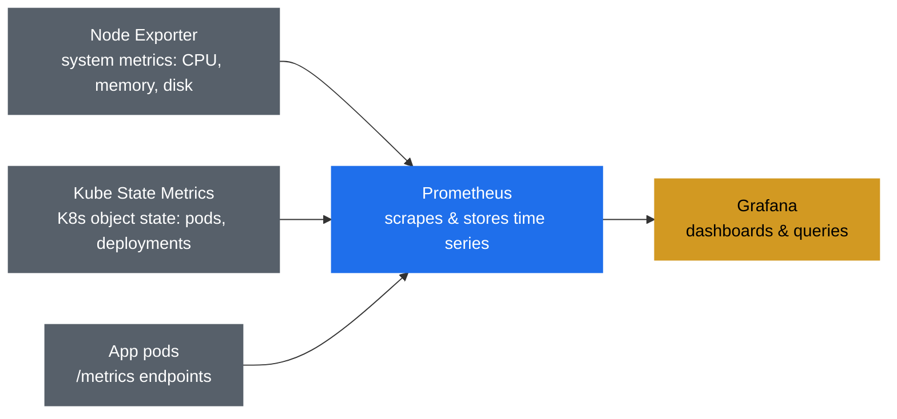

## 🚀 Setup

### 1. Cluster Configuration

**kind-config.yaml**
```yaml
kind: Cluster
apiVersion: kind.x-k8s.io/v1alpha4
nodes:
  - role: control-plane
    extraPortMappings:
      - containerPort: 80
        hostPort: 80
        protocol: TCP
      - containerPort: 30002 # prometheus
        hostPort: 30002
        protocol: TCP
      - containerPort: 30003 # grafana
        hostPort: 30003
        protocol: TCP
```

```bash
kind create cluster --config kind-config.yaml
```

### 2. Install Stack

```bash
kubectl create namespace monitoring

# Add repositories
helm repo add prometheus-community https://prometheus-community.github.io/helm-charts
helm repo update

# Install
helm install monitoring prometheus-community/kube-prometheus-stack -f ./observability/monitoring/monitoring-values.yml -n monitoring
```

### 3. Expose Services

```bash
# Prometheus
kubectl patch svc monitoring-kube-prometheus-prometheus -n monitoring \
  -p '{"spec": {"type": "NodePort", "ports": [{"port": 9090, "targetPort": 9090, "nodePort": 30002}]}}'

# Grafana
kubectl patch svc monitoring-grafana -n monitoring \
  -p '{"spec": {"type": "NodePort", "ports": [{"port": 80, "targetPort": 3000, "nodePort": 30003}]}}'
```

## 🔗 Access URLs

- **Prometheus:** [http://localhost:30002](http://localhost:30002)
- **Grafana:** [http://localhost:30003](http://localhost:30003) - `admin/password`

---

## 📈 Prometheus

Query metrics using PromQL, view targets, and configure alerts.

<table>
<tr>
<td width="50%">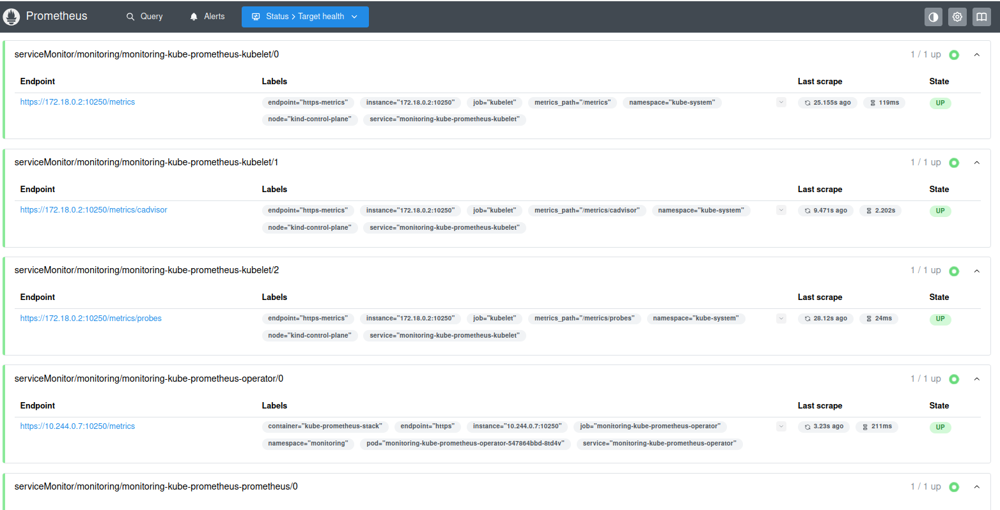</td>
<td width="50%">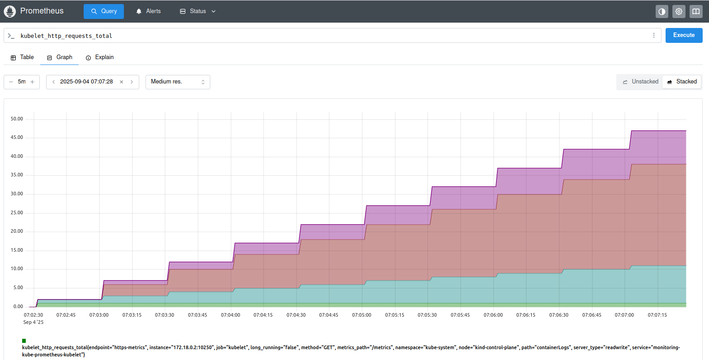</td>
</tr>
</table>

---

## 📊 Grafana

Pre-configured dashboards for cluster overview, node metrics, pod performance etc.

<table>
<tr>
<td width="50%">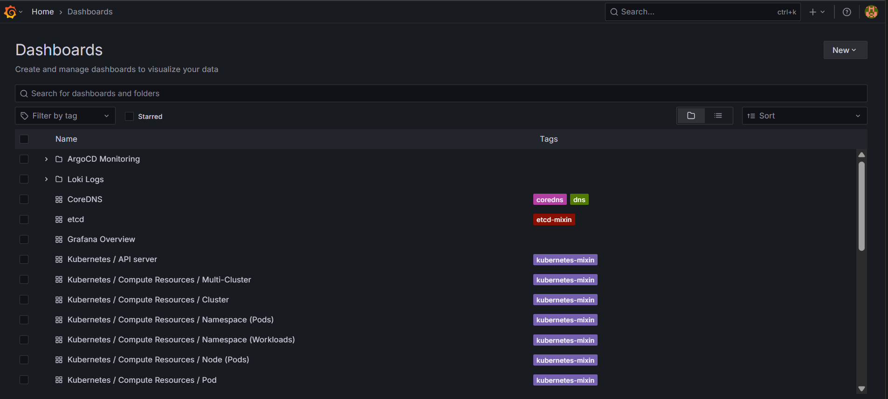</td>
<td width="50%">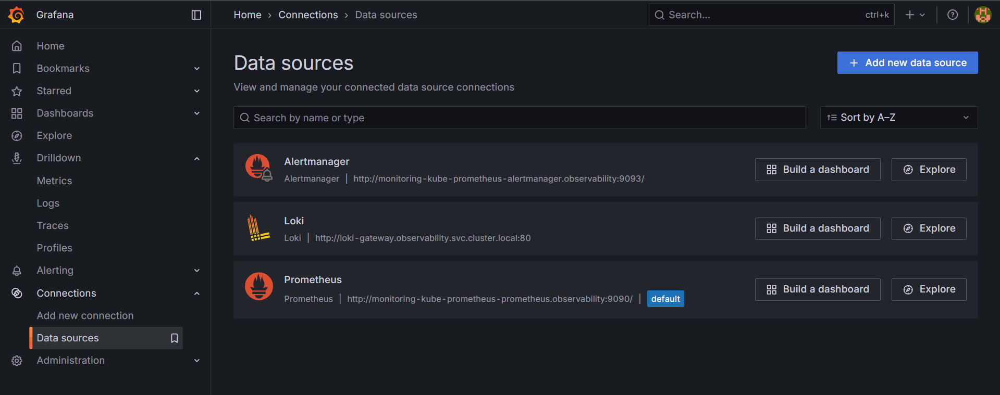</td>
</tr>
</table>

### Drilldown

<table>
<tr>
<td width="50%">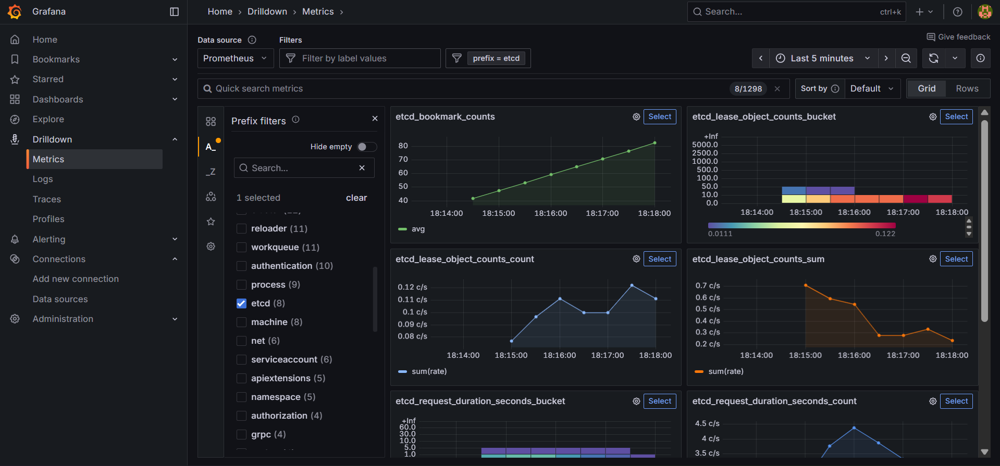</td>
</tr>
</table>

---

## 🎨 Dashboards

<table>
<tr>
<td width="50%">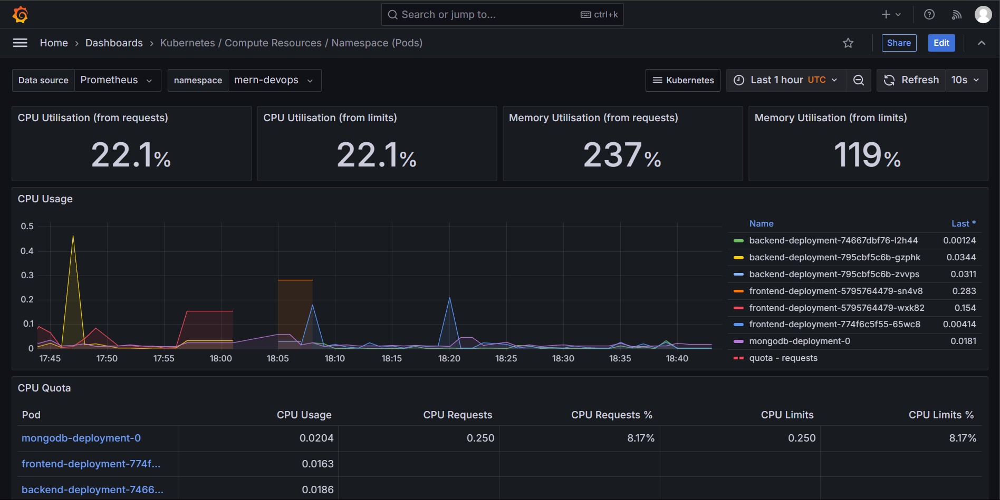</td>
<td width="50%">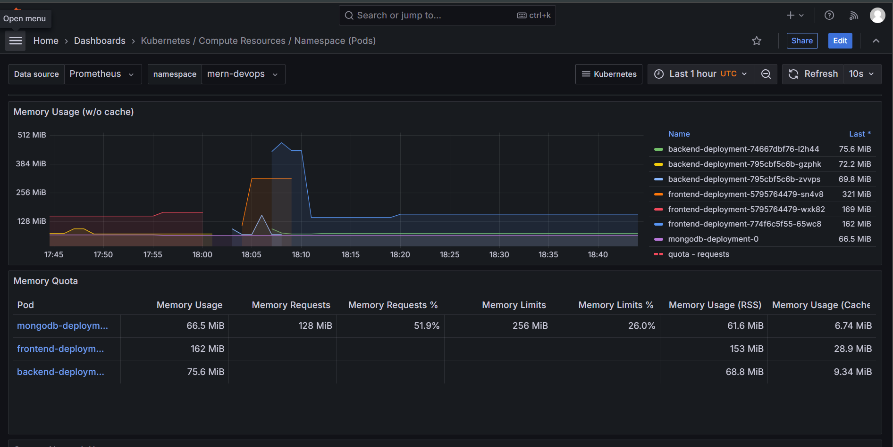</td>
</tr>
<tr>
<td width="50%">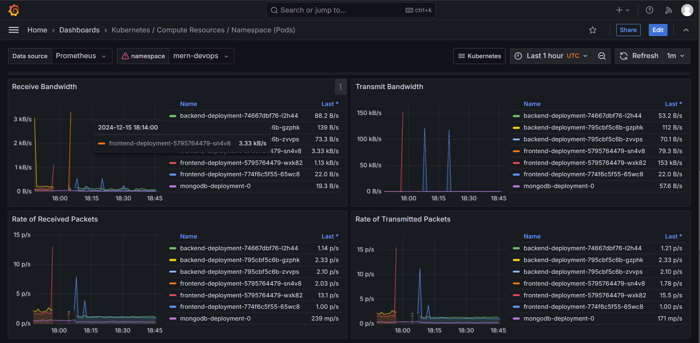</td>
<td width="50%">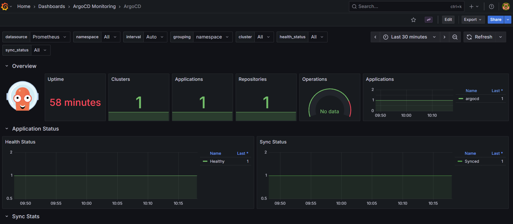</td>
</tr>
</table>

---

## 🚨 Alerting

Alert routing, a curated set of chart alerts, custom alerts with runbooks, and a dead man's switch that pages when the monitoring stack itself goes silent.

| File | Holds |
|---|---|
| `observability/monitoring/values-alerting.yml` | Routing, inhibit rules and `defaultRules` curation, shared by kind and EKS |
| `terraform/templates/values-alerting-eks.yml.tftpl` | EKS-only overlay: SNS receivers, mail template, IRSA annotation, heartbeat route |
| `observability/monitoring/alerts/*.yml` | 13 custom `PrometheusRule`s (deployments, statefulsets, containers, ArgoCD) |
| `terraform/alerting.tf` | SNS topics, Alertmanager IRSA role, dead man's switch alarm, Helm release, rule apply |
| [`AlertRunbooks.md`](./AlertRunbooks.md) | One runbook per custom alert and for the heartbeat alarm, linked from each alert's `runbook_url` |

### What is curated

The chart ships about 120 alerts. `values-alerting.yml` turns off whole groups that are not actionable on EKS (control plane, etcd, kube-proxy, NIC flapping, Windows) and individual alerts that are always firing at small cluster sizes or meaningless with one Alertmanager replica. Each group of removals carries a comment saying why.

- `severity` of `info` or `none` routes to the `null` receiver: still visible in the Alertmanager UI, never sent.
- The 13 custom alerts are two-tier where a condition has a "bad" and a "worse" state, so the severe alert inhibits the lesser one (for example `DeploymentFullyDown` over `DeploymentDegraded`).
- `critical` alerts repeat every 3h, everything else every 12h.

> [!NOTE]
> `defaultRules.disabled` only filters alerts inside an enabled group, and an unknown alert name is silently ignored. The list was written against chart `88.5.4` (pinned in `terraform/variables.tf`); re-check it with `helm template` when bumping the chart.

> [!IMPORTANT]
> Every alert is cause-based (a pod is down, a disk is filling). There are no symptom-based alerts on user-facing error rate or latency, which is what [SRE Workbook ch.5](https://sre.google/workbook/alerting-on-slos/) calls for. That layer is still missing.

### kind

Layer the alerting values over the base values and apply the rules:

```bash
helm upgrade --install monitoring prometheus-community/kube-prometheus-stack \
  --version 88.5.4 -n monitoring \
  -f ./observability/monitoring/monitoring-values.yml \
  -f ./observability/monitoring/values-alerting.yml

kubectl apply -f ./observability/monitoring/alerts/
```

Nothing is delivered on kind: every route ends at the `null` receiver, so alerts show up in the Alertmanager UI only. To get notifications, add a receiver and route in a values overlay (a commented webhook example sits in `values-alerting.yml`). There is no dead man's switch on kind.

### EKS

Set `enable_monitoring = true` and your addresses in a gitignored `*.tfvars`:

```hcl
enable_monitoring     = true
alert_email_addresses = ["you@example.com"]
```

```bash
terraform -chdir=terraform apply
```

This creates the SNS topics and IRSA role, installs the chart as release `monitoring` with the three values layers, and applies `observability/monitoring/alerts/` with `kubectl` (so your kubeconfig must already point at the new cluster, as for the ArgoCD step).

- **Confirm the subscriptions.** Each address gets two emails from AWS, one per topic. An unconfirmed subscription receives nothing.
- **A default StorageClass must exist.** The chart's PVCs use the cluster default (kind's `standard` is dropped on EKS), and EKS Auto Mode creates none, so create one first or the PVCs stay `Pending`.
- **The release name is pinned to `monitoring`.** The rule selector label and the Alertmanager service-account name in the IRSA trust policy both derive from it.
- **Restart Alertmanager if the IRSA annotation is added later.** The token is injected when the pod is created, so a running pod falls back to the node role and every publish fails with `403 ... not authorized to perform: SNS:Publish`. A fresh install is unaffected.

  ```bash
  kubectl delete pod -n monitoring alertmanager-monitoring-kube-prometheus-alertmanager-0
  ```

### Dead man's switch

`Watchdog` is an alert that fires permanently by design, so it only has value if something notices when it *stops*. Here that something lives in AWS, outside the cluster:

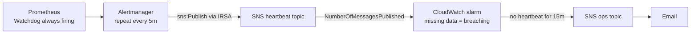

The alarm fires when a full 15-minute window passes with no publish, so a single late heartbeat does not page. Prometheus down, Alertmanager down, a broken IRSA role or an SNS outage all stop the stream and fire it. The ops topic is separate from the alerts topic so a misrouted Alertmanager cannot also silence the alarm that reports it.

Expect one alarm email right after the first install, before the first heartbeat arrives; it clears to OK within a few minutes.

### Verify delivery

```bash
kubectl port-forward -n monitoring svc/monitoring-kube-prometheus-alertmanager 9093:9093 &
curl -XPOST localhost:9093/api/v2/alerts -H 'Content-Type: application/json' -d '[{
  "labels": {
    "alertname": "TestPage", "severity": "critical",
    "namespace": "monitoring", "job": "should-not-appear-in-body"
  },
  "annotations": {
    "summary": "Test alert -- delivery check, no action needed",
    "description": "Synthetic alert verifying SNS delivery and body formatting.",
    "runbook_url": "https://github.com/atkaridarshan04/cloudnative-devops-blueprint/blob/main/docs/AlertRunbooks.md"
  }
}]'
```

The mail shows the summary, the description, one label per line, `firing since` and the runbook link. `job` must be absent: it is on the exclude list, and seeing it means the template did not load. Publish failures are logged, not surfaced:

```bash
kubectl logs -n monitoring alertmanager-monitoring-kube-prometheus-alertmanager-0 \
  -c alertmanager | grep -i "Notify for alerts failed"
```

Resolve the test alert and confirm the resolved notification arrives:

```bash
curl -XPOST localhost:9093/api/v2/alerts -H 'Content-Type: application/json' -d '[{
  "labels": { "alertname": "TestPage", "severity": "critical",
              "namespace": "monitoring", "job": "should-not-appear-in-body" },
  "endsAt": "2000-01-01T00:00:00Z"
}]'
```

### Verify the dead man's switch

First confirm the alarm sits in `OK`, not `INSUFFICIENT_DATA` (it should be `OK` within ~15 minutes of the first sync):

```bash
aws cloudwatch describe-alarms --alarm-name-prefix "$(terraform -chdir=terraform output -raw cluster_name)-alertmanager-heartbeat" \
  --query 'MetricAlarms[].[AlarmName,StateValue]' --output text
```

Then prove it pages. A silenced alert is not notified, so silencing `Watchdog` stops the heartbeat without touching the cluster:

```bash
curl -XPOST localhost:9093/api/v2/silences -H 'Content-Type: application/json' -d '{
  "matchers": [{"name": "alertname", "value": "Watchdog", "isRegex": false}],
  "startsAt": "'"$(date -u +%Y-%m-%dT%H:%M:%SZ)"'",
  "endsAt": "'"$(date -u -v+1H +%Y-%m-%dT%H:%M:%SZ)"'",
  "createdBy": "deadmans-switch-test", "comment": "testing heartbeat alarm"
}'
```

After about 15-20 minutes the ops topic emails an `ALARM`. Expire the silence in the Alertmanager UI (or `DELETE /api/v2/silence/<id>`) and an `OK` email follows. (`date -v+1H` is the macOS form; use `date -u -d '+1 hour'` on Linux.)
