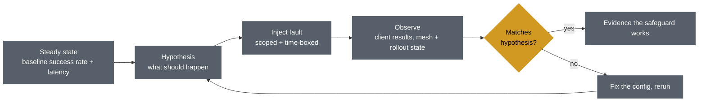

# 💥 Chaos Engineering

> Hands-on guide: [ChaosEngineering.md](../ChaosEngineering.md)

## The problem it solves

This repo configures a lot of resilience on paper: Istio retries and timeouts in a `VirtualService`, circuit breaking (outlier detection) in a `DestinationRule`, readiness probes, an HPA, and Argo Rollouts canaries that are supposed to abort on bad metrics. Reviewing that YAML tells you what you *asked for*. It does not tell you what the system *does* when a pod dies, a link slows down, or a canary misbehaves.

Chaos engineering closes that gap: inject a real, controlled failure, write down what you expect to happen beforehand (the hypothesis), then check whether it did.

## What it proves that config review can't

- **The config is wired to something real.** A `retryOn` list, a selector, or a Prometheus query can be syntactically valid and still never fire. Only a failure shows whether it does.
- **Which safety net actually catches the failure.** Several mechanisms overlap (readiness probes, retries, load-balancer choice, outlier detection). When a fault is injected, the first one to react hides the others, and you find out which one is really doing the work.
- **The cost of the recovery.** "Survived" can still mean a few seconds of tail latency or a visible error window. Reading YAML never shows that.
- **The gaps between components.** Each tool works in isolation; the interesting bugs live at the seams (for example, a retry policy that masks the very errors a canary analysis is supposed to see).

## The experiment loop

Two habits keep this safe: scope every experiment to specific pods with label selectors, and give every experiment a `duration` (or delete it) so the fault always ends.

## Why Chaos Mesh here

Chaos Mesh and Litmus both work on Kubernetes. Chaos Mesh was chosen because every experiment is a single namespaced CRD (`PodChaos`, `NetworkChaos`, `StressChaos`, `HTTPChaos`) applied with `kubectl apply`, which fits the GitOps style of the rest of this repo and needs no separate workflow engine or portal. Litmus adds a ChaosHub, probes and a web UI, which are useful at larger scale but more than this blueprint needs.
